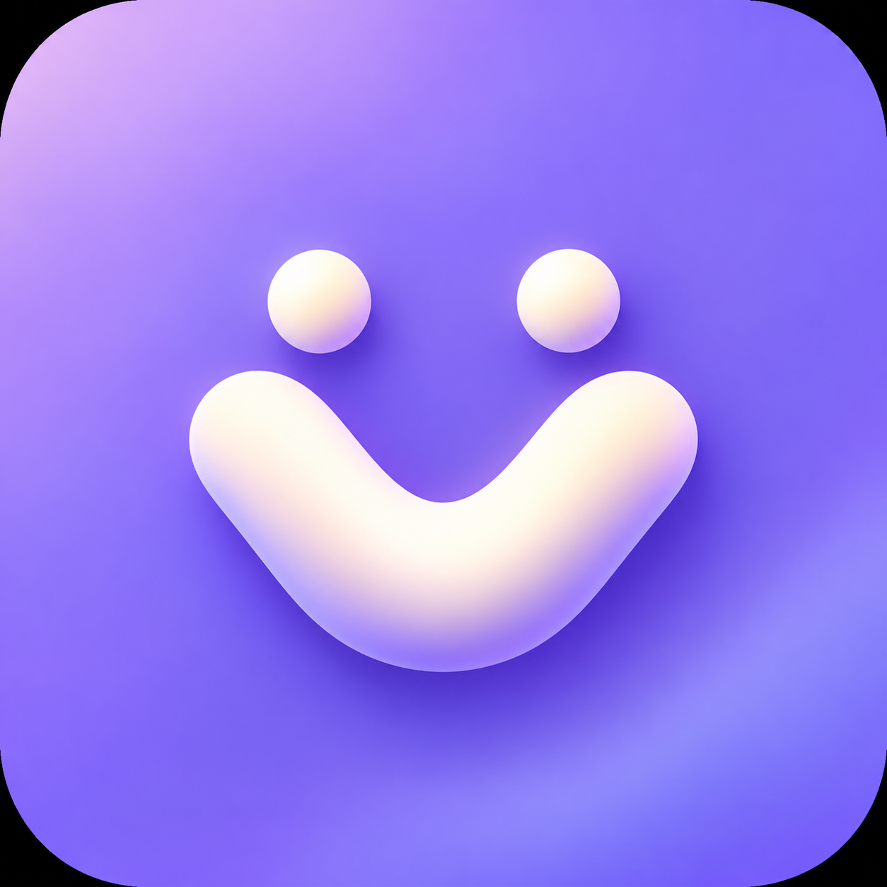

# VFriend icon concepts

原创探索稿。用户已改选 Companion V；正式 Web 与 Android 资源由 design/brand/icon.json 的平滑矢量轮廓生成。采用内置 imagegen 生成；完整提示词见 [prompts.md](prompts.md)。

| Companion V · 双伙伴 | Conversation V · 对话 |
| --- | --- |
|  |  |
| Friendly Face · 笑脸 | Quiet V · 字母标识 |
|  |  |

当前已选定 **Companion V（双伙伴 V）**。正式版保留两个伙伴组成的 V、浅紫色背景和柔和折面，生成同一套 Web、Android 彩色及单色矢量资源。Conversation V 为先前采用的方向，和其余探索稿一并保留。正式资源见 [brand/README.md](../brand/README.md)。

## 检索参考（2026-10-25）

- [Replika 官网](https://replika.com/) 与 [官方 App Store 页面](https://apps.apple.com/us/app/replika-ai-companion-chat/id1158555867)。
- [Character.AI 官方 App Store 页面](https://apps.apple.com/us/app/character-ai-chat-talk-text/id1671705818)。
- [Pi 官方 App Store 页面](https://apps.apple.com/us/app/pi-your-personal-ai/id6445815935)。
- [Nomi 官网](https://nomi.ai/)。
- [Android 官方自适应图标规范](https://developer.android.com/develop/ui/compose/system/icon_design_adaptive)。

检索中能看到字母缩写、抽象几何、亲和表情等不同视觉语言；搜索图片同时含历史版本，不把它们当作最新官方资产。这里借鉴的是简洁轮廓、品牌可辨识性与亲近感，没有直接复制第三方商标。

正式 Android 资源提供前景、背景和单色层，按官方 108 dp 图层与中央 66 dp 安全区检查圆形及圆角裁切，同时提供单色主题图层。Web favicon 与 Android 启动器图标使用同一选定标识。
